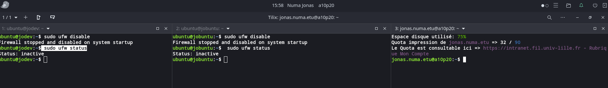
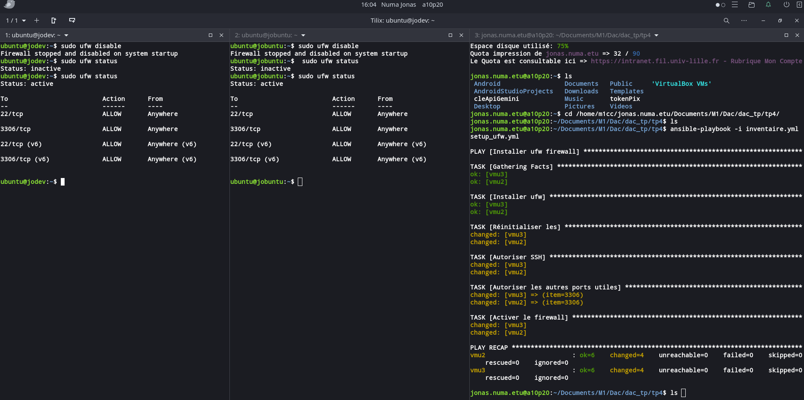
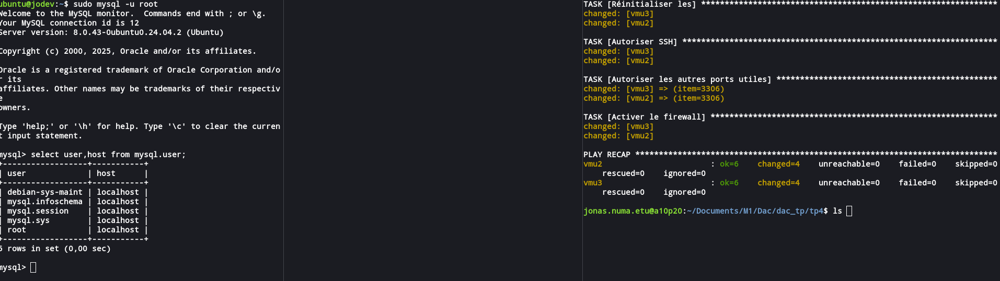
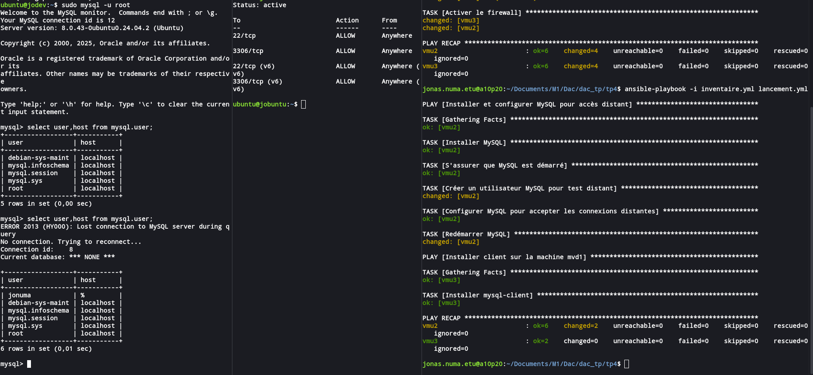

# TP4

## Configurations des machines virtuelles

Les machines virtuelles à ma disposition :  

1. `vmu1@172.28.101.75` (machine -> juntu)  
2. `vmu2@172.28.100.101` (machine -> jobuntu)  
3. `vmu3@172.28.100.116` (machine -> jodev)  

---

## 1. Configuration d'un fichier **inventaire**

Pour l’instant, on utilisera les machines `vmu2` et `vmu3`.  
Le fichier est nommé `inventaire.yml` :

```yaml
sgbd:
  hosts:
    vmu2:
      ansible_host: 172.28.100.101
      ansible_user: ubuntu

client:
  hosts:
    vmu3:
      ansible_host: 172.28.100.116
      ansible_user: ubuntu
```

### Sécurisation des instances depuis ma poste locale
 j'ai configurer un fichier setup_ufw.yml qui met en place la securite sur toutes les machines.


```
- name: Installer ufw firewall
  hosts: all
  become: true
  tasks:
    - name: Installer ufw
      apt:
        name: ufw
        state: present
        update_cache: yes
    - name: Réinitialiser les règles d'avant
      ufw:
        state: reset

    - name: Autoriser SSH
      ufw:
        rule: allow
        port: 22
        proto: tcp

    - name: Autoriser les autres ports utiles
      ufw:
        rule: allow
        port: "{{ item }}"
        proto: tcp
      loop:
        - 3306

    - name: Activer le firewall
      ufw:
        state: enabled
        policy: deny
```

Avant la requete

après la requete


### Sécurisation des instances depuis mon poste local

J'ai configuré un fichier setup_ufw.yml pour mettre en place la sécurité sur toutes les machines :


Avant la requete

après la requete


## Partie 2
### 2.1 fichier d'inventaire
2.1 Fichier d'inventaire

Pour commencer, j'ai écrit un fichier d’inventaire avec deux groupes `[serveur]` et `[proxy]` :

Le groupe `[serveur]` contient les informations pour faire la réplication master-master.

Le groupe `[proxy]` contient le serveur servant de relais entre les deux maîtres.

**inventaire.yml** :

```yaml
serveur:
  hosts:
    master1:
      ansible_host: 172.28.100.229
      ansible_user: ubuntu
      ansible_private_key_file: '/home/jonuma/.ssh/cloud.key'
      server_id: 1

    master2:
      ansible_host: 172.28.100.101
      ansible_user: ubuntu
      ansible_private_key_file: '/home/jonuma/.ssh/cloud.key'
      server_id: 2

proxy:
  hosts:
    proxy1:
      ansible_host: 172.28.100.116
      ansible_user: ubuntu
      ansible_private_key_file: '/home/jonuma/.ssh/cloud.key'
    
```
### 2.2 Le main playbook
J'ai en mise en un playbook dans la racine du projet avec comme contenu. **mysql_config.yml**
```yaml
- hosts: serveur
  remote_user: ubuntu
  become: true

  vars:
    peer: "{{ groups['serveur'] | difference([inventory_hostname]) | first }}"
    peer_ip: "{{ hostvars[peer].ansible_host }}"

  roles:
    - python_bib
    - installation
    - securisation
    - common
    - master
    - slave
    - creation
    
```
Voici la commande pour lancer les taches pour mettre en place la configuration est depuis la racine du repertoire **tp4**
```bash
ansible-playbook -i inventaire.yml config_mysql.yml
```
### 2.3 Détails sur les roles.
**nb: les éléments de la liste sont cliquables**

- [python_bib](./roles/python_bib/tasks/main.yml) : role pour mettre en place bibliothèques python nécéssaires pour **community.mysql**.

- [installation](./roles/installation/tasks/main.yml) : role pour installer et lancer mysql si nécéssaire.

- [securisation](./roles/securisation/tasks/main.yml) : role pour securiser les machines virtuelles.

- [common](./roles/common/tasks/main.yml) :rôle pour les configurations communes avant la réplication entre les serveurs du groupe concerné.

- pour la replication 
  - [master](./roles/master/tasks/main.yml) : 

  - [slave](./roles/slave/tasks/main.yml) : 
Ces deux roles sont modulaires et permettrent de faire la replication master-slave, apppele sur les deux serveurs cela nous une configuration master-master.
- [creation](./roles/creation/tasks/main.yml) : role sert a créer une base et un utilisateur avec des variables definis dans le fichier.

