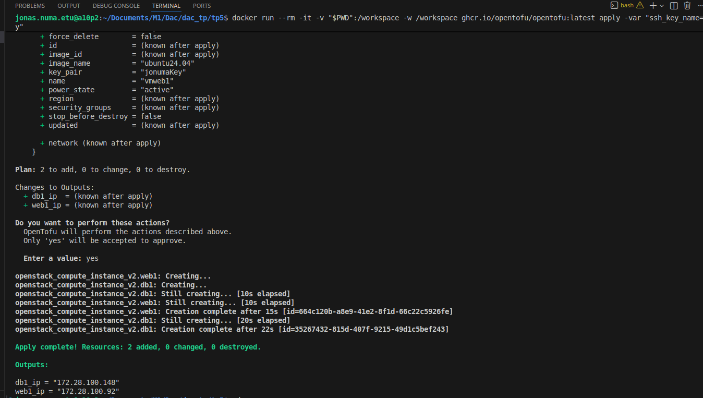
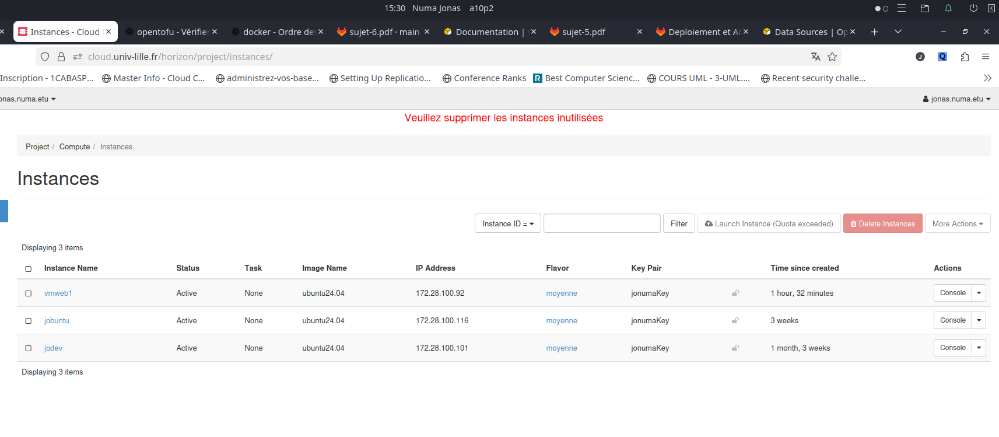
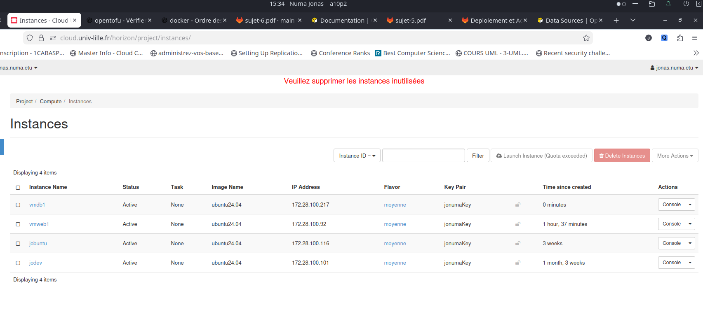
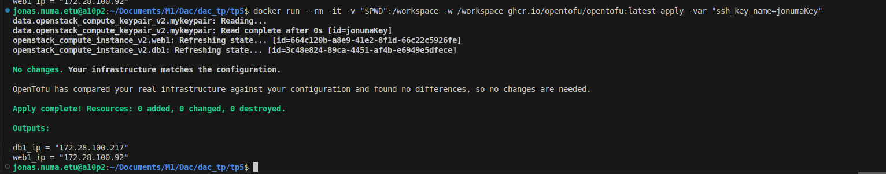

# TP5 Provisionnement avec OpenTofu

## Objectif 
Nous allons automatiser le provisionnement cloud avec à Open-Tofu en créant un script OpenTofu allouans deux machines virtuelles en respectant ces instructions.

- Les machines doivent avoir des noms identifiant des fonctions potentielles,e.g. db1 et web1
- Le configuration ne doit contenir aucun mot de passe en clair ou l’exécution du script ne doit pas en afficher
- Les machines doivent être accessible en SSH depuis une clef préalablement enregistrée sur l’interface d’OpenStack
- La clef SSH doit être reconfigurable sans éditer le script
- Le script doit exporter les adresses IP des machines respectives
- Si une machine est supprimée, exécuter le script doit en réallouer une
- La configuration doit être idempotente

## 1. Les étapes

### 1.1 Accès à Opentofu

### 1.1.1 Installation de OpenTofu (Linux Ubuntu) depuis le site officiel

Le lien: [https://opentofu.org/docs/intro/install/alpine/](https://opentofu.org/docs/intro/install/alpine/)

Ou vous trouvez le script bash d'installation suivant

```bash
# Download the installer script:
curl --proto '=https' --tlsv1.2 -fsSL https://get.opentofu.org/install-opentofu.sh -o install-opentofu.sh
# Alternatively: wget --secure-protocol=TLSv1_2 --https-only https://get.opentofu.org/install-opentofu.sh -O install-opentofu.sh

# Give it execution permissions:
chmod +x install-opentofu.sh

# Please inspect the downloaded script

# Run the installer:
./install-opentofu.sh --install-method apk

# Remove the installer:
rm -f install-opentofu.sh
```
### 1.1.2 Utlisation de Docker
Si vous avez docker installé sur votre machine vous pouvez utliser cette commande bash.

```bash
docker run --rm -it -v "$PWD":/workspace -w /workspace ghcr.io/opentofu/opentofu:latest <action>
```
`action = init | plan |apply | ...` 

## 1.2 Installation du provider
On va initialiser le provider avec cette declaration dans le ficher `main.tf`

```hcl
terraform {
  required_version = ">= 0.14.0"
  required_providers {
    openstack = {
      source  = "terraform-provider-openstack/openstack"
      version = "~> 1.53.0"
    }
  }
}
```

## 1.3 mise en appplication des objectif

### 1.3.1 Noms des machines
La machine vmweb1
```hcl
resource "openstack_compute_instance_v2" "web1"{
 name            = "vmweb1"
 ...
 }
 ```
 et la machine vmdb1
```hcl
resource "openstack_compute_instance_v2" "db1"{
 name            = "vmdb1"
 ... 
 }
 ```
### 1.3.2 Gestion sécurisée des identifiants sans mot de passe en clair
` password    = var.os_password`
variable definie dans le fichier [terraform.tfvars](./terraform.tfvars)
### 1.3.3 accessibilité en SSH depuis une clef préalablement enregistrée sur OpenStack
` key_pair        = data.openstack_compute_keypair_v2.mykeypair.name`
### 1.3.4 La clef SSH doit être reconfigurable sans éditer le script
```hcl
variable "ssh_key_name" {
  description = "Nom du keypair SSH pour les VM"
  type        = string
}
```
Exemple d'application avce l'action `apply`.
nouvelle commande: 
```bash
tofu apply -var 'ssh_key_name=jonumaKey'
```
### 1.3.5 Le script doit exporter les adresses IP des machines respectives
Configuration des outputs dans le fichier [main.tf](./main.tf).
```hcl
output "web1_ip" {
  value = openstack_compute_instance_v2.web1.access_ip_v4
  description = "Adresse IP de la VM web1"
}


output "db1_ip" {
  value = openstack_compute_instance_v2.db1.access_ip_v4
  description = "Adresse IP de la VM db1"
}
```
#### 1.3.5.1 visible après un `tofu apply`

#### 1.3.5.1 depuis le cache dans le fichier [terraform.tfstate](./terraform.tfstate)
avec la commande:
```bash
tofu output
```
### 1.3.6 Si une machine est supprimée, exécuter le script doit en réallouer une
vmdb1 suppriméé
 
vmdb1 retablie après l'éxécution de la commande `tofu apply`

### 1.3.7 La configuration doit être idempotente

