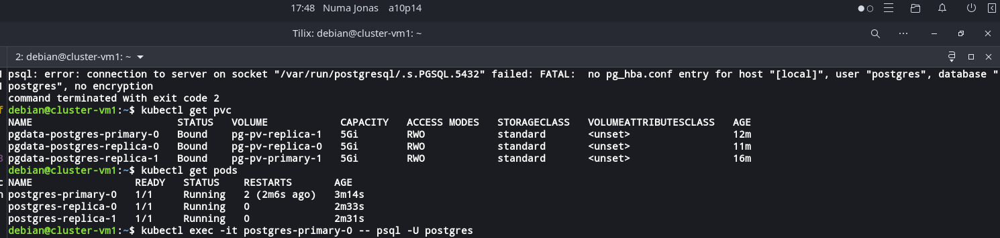

# TP8

## 1 Configuration de base

Commande pour envoyer les fichiers

```bash
scp -r postgres/ deployment.sh desinstaller.sh    debian@172.28.100.130:/home/debian
```
Je n'ai pu mettre en marche la configuration j'ai mis en place des totalement, mais les pods on bien ete lance



la commmande 

```bash
./deployment.sh
```

pour lancer 

et celle la 

```bash
./desinstaller.sh 
```